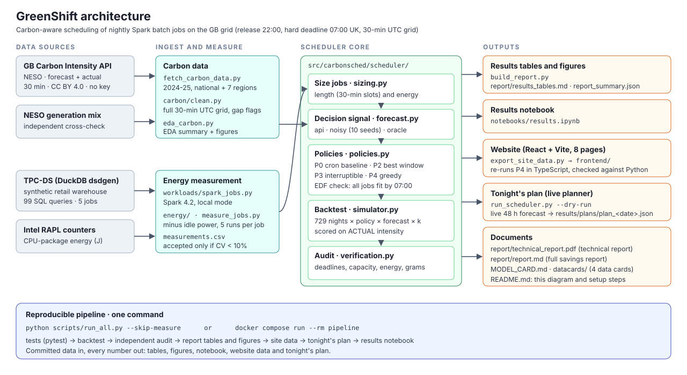

# GreenShift

**Carbon-aware scheduling of nightly Spark batch jobs:** GreenShift moves a data team's nightly Spark jobs into the cleanest hours of the GB grid between 22:00 and 07:00, without missing the deadline, and provides a RAPL-based method for measuring each job's energy.

UE24AM343AB3 Big Data Systems & Responsible AI Engineering · Mini-project, Track G (Governance, Compliance and Sustainability)
Repository: **https://github.com/VismayHS/GreenShift**

| Deliverable | Where |
|---|---|
| README with architecture diagram and setup steps | this file · [docs/architecture.svg](docs/architecture.svg) |
| Reproducible pipeline | [scripts/run_all.py](scripts/run_all.py) · [docker-compose.yml](docker-compose.yml) · [Dockerfile](Dockerfile) |
| Results notebook | [notebooks/results.ipynb](notebooks/results.ipynb) (static copy: [notebooks/results.html](notebooks/results.html)) |
| Technical report (4 pages) | [report/technical_report.pdf](report/technical_report.pdf) · source [report/technical_report.md](report/technical_report.md) |
| Model card and data cards | [MODEL_CARD.md](MODEL_CARD.md) · [datacards/](datacards/) (PDFs: [docs/model_card.pdf](docs/model_card.pdf), [docs/data_cards.pdf](docs/data_cards.pdf)) |
| Full savings report | [report/report.md](report/report.md) · tables [report/results_tables.md](report/results_tables.md) · figures [report/figures/](report/figures/) |
| Website (8 pages, live planner) | [frontend/](frontend/) |

## The case study

> *A data team wants to cut emissions from nightly jobs without missing deadlines. Measure the energy use of representative Spark jobs. Use public grid carbon-intensity data to shift flexible jobs to cleaner time windows. Report emissions saved and any added delay.*

A job's emissions are `kWh × PUE × carbon intensity`. Moving a job in time leaves its kWh unchanged but changes the intensity it runs on. GreenShift reads NESO's half-hourly GB carbon-intensity forecast and, every night, places five TPC-DS-derived Spark jobs in the cleanest window that still finishes by 07:00. Every saving is scored against the grid's **actual** intensity, never the forecast.

## Results at a glance

Backtest over every night of 2024-2025 (729 nights, 437,448 rows), policy P4, one job at a time (*k* = 1):

| Forecast | CO₂ saved vs cron [95% CI] | Median added delay | Deadline misses |
|---|---|---|---|
| Real NESO forecast | **5.09%** [4.53, 5.72] | 2.5 h | **0** |
| Perfect forecast (ceiling) | 7.68% [7.10, 8.26] | 1.5 h | 0 |

With two parallel slots (*k* = 2) the saving is 9.87%. Replicating Wiesner et al. (±2 h window) gives 4.45% against the paper's 4.3%.

The backtest uses modelled job lengths (30 to 120 minutes) with equal energy per job, so savings are reported as percentages.

## Architecture



1. **Carbon data.** [`fetch_carbon_data.py`](scripts/fetch_carbon_data.py) downloads 2024-25 national and regional intensity from the NESO Carbon Intensity API. [`carbon/clean.py`](src/carbonsched/carbon/clean.py) puts it on a full 30-minute UTC grid with gap flags. [`eda_carbon.py`](scripts/eda_carbon.py) produces the analysis and the cross-check against NESO's generation-mix series.
2. **Energy measurement.** [`workloads/spark_jobs.py`](src/carbonsched/workloads/spark_jobs.py) runs grouped TPC-DS queries on Spark 4.2. [`energy/`](src/carbonsched/energy/) reads Intel RAPL counters and subtracts idle power. [`measure_jobs.py`](scripts/measure_jobs.py) runs the protocol and accepts a job only if its runs agree within 10%.
3. **Scheduler core** ([`src/carbonsched/scheduler/`](src/carbonsched/scheduler/)):
   - [`sizing.py`](src/carbonsched/scheduler/sizing.py) sets each job's length and energy.
   - [`forecast.py`](src/carbonsched/scheduler/forecast.py) supplies the decision signal (real, noisy or perfect forecast).
   - [`policies.py`](src/carbonsched/scheduler/policies.py) implements P0 cron, P2 best window, P3 interruptible and P4 greedy with an earliest-deadline-first check.
   - [`simulator.py`](src/carbonsched/scheduler/simulator.py) runs the backtest.
   - [`verification.py`](src/carbonsched/scheduler/verification.py) audits every row independently.
4. **Outputs.**
   - [`build_report.py`](scripts/build_report.py) writes the tables and figures.
   - [`notebooks/results.ipynb`](notebooks/results.ipynb) recomputes the headline from the raw rows.
   - [`export_site_data.py`](scripts/export_site_data.py) feeds the website.
   - [`run_scheduler.py`](scripts/run_scheduler.py) plans tonight from the live forecast.

## Setup

### Option A: Docker Compose (nothing to install but Docker)

```bash
git clone https://github.com/VismayHS/GreenShift.git && cd GreenShift
docker compose run --rm pipeline     # tests → backtest → audit → report → site data → notebook (offline)
docker compose up --build site       # website on http://localhost:4173 (Ctrl+C to stop)
```

Outputs are written into your checkout. On Linux, if your user id is not 1000, prefix the first command with `HOST_UID=$(id -u) HOST_GID=$(id -g)`.

### Option B: local Python (Linux, macOS or Windows)

Requires Python 3.12 and, for the website, Node.js 20.19+ (or 22.12+).

```bash
git clone https://github.com/VismayHS/GreenShift.git && cd GreenShift
python3.12 -m venv .venv && source .venv/bin/activate       # Windows: .venv\Scripts\activate
pip install -r requirements-dev.txt
python scripts/run_all.py --skip-measure                     # every number in the report, notebook and site (1-3 min)
cd frontend && npm install && npm run dev                    # website on http://localhost:5173
```

- Add `--offline` to `run_all.py` to keep the stored 48-hour forecast instead of fetching a fresh one.
- On Ubuntu 24.04, npm 10.8 crashes on this dependency tree. Use `npx npm@11 install` instead of `npm install`.

### Everyday commands

| Task | Command |
|---|---|
| Run the tests | `python -m pytest -q` |
| Plan tonight from the live forecast | `python scripts/run_scheduler.py --dry-run` (add `--offline` to use the stored forecast) |
| Re-execute only the notebook | `jupyter nbconvert --to notebook --execute --inplace notebooks/results.ipynb` |
| Rebuild the PDFs and the notebook HTML | `python scripts/build_docs.py` (needs Chrome or Chromium) |
| Re-download the carbon data | `python scripts/fetch_carbon_data.py --start 2024-01-01 --end 2026-01-01` (resumable) |
| Re-run the carbon-data analysis | `python scripts/eda_carbon.py` |

### Measuring energy (the RAPL laptop only)

Spark 4.2 needs Java 17, 21 or 25. On Windows, place a JDK 21 in `.tools\jdk-21*\` (`carbonsched.env` finds it).

```powershell
.venv\Scripts\python scripts\generate_tpcds.py --sf 1      # TPC-DS data with DuckDB, no C toolchain needed
.venv\Scripts\python scripts\run_all.py                    # measure first (AC power, lid open), then everything else
```

The full protocol and acceptance rules are in [docs/PERSON2.md](docs/PERSON2.md) and [docs/PERSON2_STATUS.md](docs/PERSON2_STATUS.md).

## Repository layout

```text
configs/            job catalogue (jobs.json) and backtest settings (scheduler.json)
data/raw/carbon/    committed GB carbon-intensity CSVs, 2024-25 (national + regions 1-7)
datacards/          one data card per dataset
docs/               architecture diagram, model and data card PDFs, team handoff notes
frontend/           React 19 + Vite website
notebooks/          results notebook (+ static HTML copy)
report/             technical report (PDF), full savings report, generated tables and figures
results/            backtest outputs, audit, summaries, measurement attempts, live plans
scripts/            pipeline steps; run_all.py runs them in order
src/carbonsched/    library: carbon/, energy/, scheduler/, workloads/
tests/              pytest suite (50 tests)
```

## Data and licences

| Dataset | Licence | Data card |
|---|---|---|
| GB Carbon Intensity API (NESO) | CC BY 4.0 | [datacards/uk_carbon_intensity_api.md](datacards/uk_carbon_intensity_api.md) |
| NESO historic generation mix | CC BY 4.0 | [datacards/neso_historic_generation_mix.md](datacards/neso_historic_generation_mix.md) |
| TPC-DS-derived workload (DuckDB `dsdgen`) | TPC EULA / fair use | [datacards/tpcds.md](datacards/tpcds.md) |
| Electricity Maps (substituted, not used) | ODbL / non-commercial API | [datacards/electricity_maps.md](datacards/electricity_maps.md) |

Carbon intensity data: Carbon Intensity API, NESO (CC BY 4.0). Workload derived from TPC-DS; results are not comparable with published TPC-DS results.

## Team

| Member | Contribution |
|---|---|
| Vismay HS (PES1UG24AM325) | Research and design, carbon-data fetcher, cleaning and analysis, energy meter, TPC-DS on Spark, Linux/Hadoop setup, data cards, first website |
| [Sharvesh K](https://github.com/SharveshK1228) (PES1UG24AM260) | Measurement campaign tooling and sessions, scheduler policies, simulator, forecast modes, replication scenario, independent auditor, tests, live demo command |
| Ashwin C H (PES1UG24AM900) | Savings analysis and report, results tables and figures, website rebuild and integration, one-command pipeline, demo script, citation checks |

Full project context, decisions and the Linux/Hadoop setup guide: [docs/HANDOFF.md](docs/HANDOFF.md).
