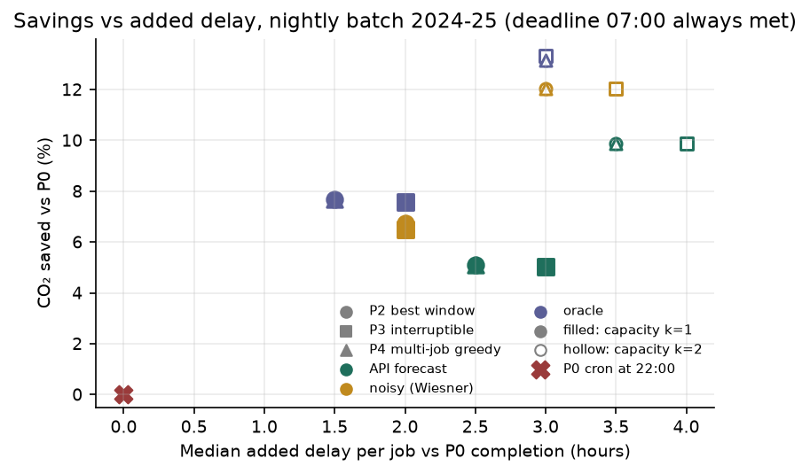
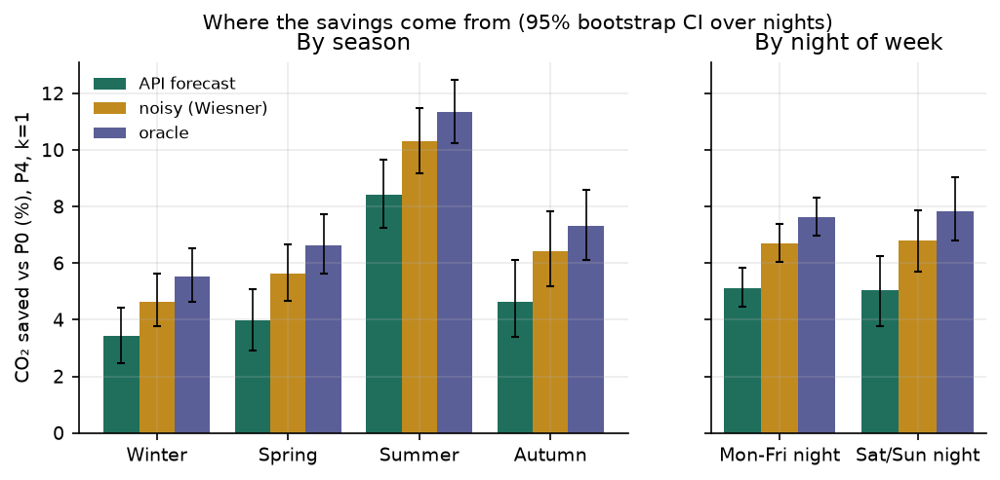
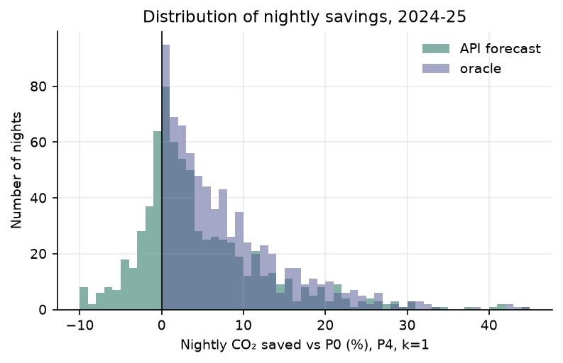
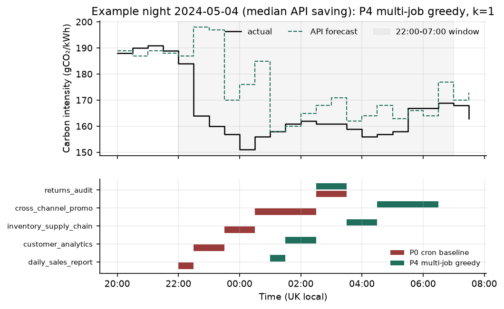
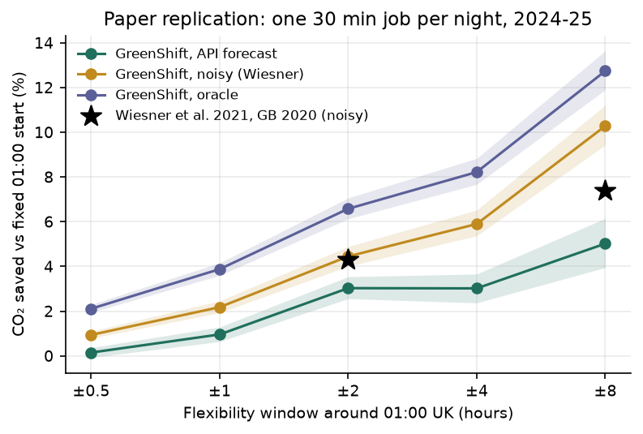

# GreenShift: carbon-aware scheduling of nightly Spark batch jobs

**Savings report** · UE24AM343AB3 Big Data Systems & Responsible AI Engineering, mini-project, Track G (Governance, Compliance and Sustainability)
**Team:** Vismay HS (PES1UG24AM325) · Sharvesh K (PES1UG24AM260) · Ashwin C H (PES1UG24AM900)
**Status of this version:** scheduler, backtest and analysis complete; **job sizes are placeholders** until the RAPL measurement campaign passes its quality gate (§3.4). Every number in §6 is regenerated by `python scripts/run_all.py --skip-measure`; values that depend on measured energy are marked **⏳ pending measurement**, never estimated.

---

## 1. Problem and context

> *Case study: a data team wants to cut emissions from nightly jobs without missing deadlines. Measure the energy use of representative Spark jobs. Use public grid carbon-intensity data to shift flexible jobs to cleaner time windows. Report emissions saved and any added delay.*

A job's emissions are its energy times the carbon intensity (CI) of the electricity it ran on:
`gCO₂ = kWh × PUE × CI(t)`. Moving a job in time does not change its kWh; it changes `CI(t)`. Great Britain's grid CI changes substantially within a night as wind, imports and gas plants change (on the median night of 2024-25 the dirtiest and cleanest half-hours differ by 48 gCO₂/kWh, about 1.5×, and by 2× or more on 18% of nights), and NESO publishes a 48-hour forecast of it every half-hour. GreenShift uses that forecast to choose, every night, when each batch job runs inside a fixed window (release 22:00, hard deadline 07:00 UK time), and reports how much CO₂ that saves against the team's current cron schedule and how much later each job finishes.

The design follows and is compared with Wiesner et al., *Let's Wait Awhile* (Middleware '21), which found GB savings of 4.3% (±2 h window) and 7.4% (±8 h) for a 30-minute nightly job in 2020.

**Deliverables and where they are**

| Brief asks for | Where |
|---|---|
| Scheduler code | `src/carbonsched/scheduler/` (policies, simulator, forecast modes, verification), `scripts/run_scheduler.py` (live planner) |
| Measurement method | `src/carbonsched/energy/` (RAPL meter, model, preflight), `scripts/measure_jobs.py`, §3 below |
| Savings report | this file, `report/results_tables.md`, `report/figures/`, and the website (`frontend/`) |

## 2. Data

Full data cards (owner, licence, access, provenance, known gaps) are in `datacards/`.

| Dataset | Use | Licence | Notes |
|---|---|---|---|
| GB Carbon Intensity API (NESO) | National forecast (decisions) and actual (scoring), 2024-01-01 to 2026-01-01, 30 min, UTC; regions 1-7 forecast | CC BY 4.0, no key | 35,088 national half-hours; 74 forecast and 31 actual slots missing in three source outages, never interpolated |
| NESO historic generation mix | Independent cross-check of the API actual | CC BY 4.0 | r = 0.993, MAE 4.66 gCO₂/kWh against the API actual |
| TPC-DS (DuckDB `dsdgen`) | Synthetic retail data and SQL for the Spark jobs | TPC EULA / fair use | *Workload derived from TPC-DS; not comparable with published TPC-DS results.* Synthetic, no personal data |
| Electricity Maps | Suggested by the brief | ODbL (datasets), non-commercial API | **Substituted.** Historical datasets are now available only to approved academic users (the portal returns 403 without an account), and the free API covers only the last 24 h. We could not obtain the Southern India (`IN-SO`) hourly 2024 file, so India was dropped as a second region. NESO data comes from the system operator itself, is CC BY 4.0, needs no key and is finer-grained (30 min); the brief allows a justified substitute |

**What the data shows** (`scripts/eda_carbon.py`, figures `report/figures/eda_*.png`):

- National mean actual CI 127.1 gCO₂/kWh. The 22:00-07:00 window averages 116.7 against 133.4 for 07:00-22:00; weekends 110.2 against 133.9 on weekdays.
- The day's cleanest half-hour falls inside 22:00-07:00 on 58.9% of days. In summer the solar midday dip (~78 at 13:00) is cleaner than the night but lies outside the window, so the scheduler cannot reach it.
- The national forecast's mean absolute error is 9.72 gCO₂/kWh, **7.6% of the mean** (bias −0.07, RMSE 13.65, n = 35,014), larger than the 5% Wiesner et al. assumed.
- Regions differ tenfold (mean forecast: South Scotland 22.1, South Wales 251.7). Regional data has no actuals, so the backtest uses the national series.

## 3. Measurement method

### 3.1 Signals

1. **Intel RAPL (primary, measured).** CPU-package and core energy counters, read through the Windows Energy Meter Interface (`\Energy Meter(RAPL_Package0_*)`, picowatt-hours, ~1 s updates) or Linux powercap (`/sys/class/powercap/intel-rapl:*`, µJ, wrap-safe).
2. **Battery discharge (cross-check).** Whole-laptop draw from WMI, only when unplugged; firmware-smoothed, so it only checks long runs.
3. **Linear utilisation model (estimate).** `P = P_idle + (P_max − P_idle)·u + 0.375 W/GB·RAM`, calibrated against RAPL by least squares. Used only where no counter exists (e.g. a cluster node) and always labelled.
4. **Spark task metrics** from the REST API: executor CPU time, run time, input and shuffle bytes, for attribution on a cluster.

### 3.2 Validation of the meter (CPU-burn tests, not job measurements)

| Machine | Test | s | RAPL J | Model J | Gap |
|---|---|---|---|---|---|
| Windows 11, i5-12450H | CPU burn, 2 procs | 5.6 | 88.0 | 92.5 | +5.1% |
| Windows 11, i5-12450H | CPU burn, 6 procs | 2.7 | 64.2 | 65.4 | +1.9% |
| Windows 11, i5-12450H | CPU burn, 12 procs | 2.4 | 68.9 | 69.2 | +0.4% |
| Ubuntu 24.04, i5-12450H | CPU burn, 12 procs | 5.0 | 167.9 | 212.2 | +26.4% (uncalibrated P_max) |

The Linux row is why the protocol recalibrates the model on every machine.

### 3.3 Protocol (implemented in `scripts/measure_jobs.py` with `energy/preflight.py` guards)

1. AC power, Windows "Best performance", other applications closed. Sleep is inhibited; a charger disconnect or suspend **aborts** the session (it is not silently continued).
2. 60 s idle baseline at the start and end of the session → `P_idle`.
3. One warm-up run per job, discarded.
4. Five measured runs per job, randomised order (seed 20261031), 20 s cool-down between runs.
5. Per run: wall time, RAPL PKG and PP0 J, mean CPU utilisation, executor CPU-s, input and shuffle bytes.
6. Report gross (RAPL PKG) and **attributable** (gross − `P_idle` × duration) energy: mean, SD, Student-t 95% CI. A job is accepted only if its coefficient of variation is below 10%. Scheduling uses attributable CPU-package energy.
7. `kWh = J / 3.6×10⁶`; `gCO₂ = kWh × PUE × CI`. PUE = 1.0 for the laptop.

**Workload.** Five jobs of grouped TPC-DS queries on Spark 4.2 (local mode, 4 cores, 8 GB driver): `daily_sales_report` (q3, 7, 19, 42, 52, 55), `customer_analytics` (q4, 11, 74), `inventory_supply_chain` (q21, 22, 37, 39, 72, 82), `cross_channel_promo` (q14, 23, 33, 56, 60, 77, 80; the only splittable job) and `returns_audit` (q16, 50, 62, 94, 95, 99). All 99 queries were timed at SF5; two SF5 campaigns exhausted the Java heap, so the catalogue uses SF1 with each query group repeated (10 to 36 times) so every run lasts well over the 30 s RAPL granularity floor.

### 3.4 Campaign status ⏳

Seven sessions were run on the measurement laptop (Windows 11, Intel i5-13450HX, 24 GB). **None passed the quality gate**; each is preserved under `results/measurement_attempts/` and none is pooled:

| Session | Outcome | Runs |
|---|---|---|
| 2026-11-02 memory-pressure | Invalidated: repeated Java heap exhaustion at SF5 | 8 |
| 2026-11-02 sf5-short-run | Failed: a job ran under 30 s | 2 |
| 2026-11-03 interrupted-reboot | Interrupted: Windows restarted during warm-ups | 0 |
| 2026-11-03 power-transition | Failed: a job ran under 30 s after warm-up; repeats doubled | 20 |
| 2026-11-03 user-paused | Paused before any run | 0 |
| 2026-11-03 user-paused-after16 | Paused after 16 runs; no closing idle baseline | 16 |
| 2026-11-04 ac-disconnect | Failed: charger disconnected during warm-up | 0 |

The longest session (16 runs, 2-4 per job) shows attributable energy varying by roughly as much as its mean between runs, far above the 10% gate, so it is reported here only as evidence that the pipeline works. **⏳ Final measurement table (gross and attributable kWh per job, SD, 95% CI, CV, calibration R²): pending one uninterrupted session.** When `results/measurements.csv` exists, `run_all.py` re-sizes the jobs (`duration_slots = ceil(measured_s × SCALE / 1800)`, `energy_kWh = attributable_kWh × SCALE × PUE`), reruns the backtest and replaces every placeholder in this report.

### 3.5 What the meter does not capture

DRAM (no counter on this CPU), SSD, network, fans, screen, power-supply losses and embodied carbon. RAPL therefore underestimates absolute energy. This does not affect the **percentage** saved (§5.4), only grams.

## 4. Scheduler design

**Model.** Each night has a release `r` = 22:00 and a deadline `D` = 07:00 UK local time, handled in UTC on a 30-minute grid (18 slots; 16 and 20 on clock-change nights). Job *j* has a length `d_j` slots, energy `E_j`, and a splittable flag. At most *k* jobs run at once (*k* = 1 or 2, a YARN queue's slots). The objective is `Σ_j E_j · mean(CI_forecast over j's slots)`.

| Policy | Rule |
|---|---|
| **P0** cron baseline | All jobs start at 22:00, back to back in catalogue order, *k* at a time |
| **P2** best window | Catalogue order; each job takes the contiguous block with the lowest mean forecast that still fits |
| **P3** interruptible | As P2, but the splittable job may take its lowest-forecast slots even if not adjacent |
| **P4** multi-job greedy | Largest energy first; each job takes its best contiguous window under capacity *k*; before accepting, an earliest-deadline-first (EDF) construction must place every remaining job by `D`; if the final plan's forecast cost exceeds cron's, cron is kept |
| P5 ILP | Not built (stretch goal) |

**Forecast modes.** `api`: the real NESO forecast (a missing slot takes the actual from 24 h earlier; 124 slots substituted across all scenario windows, counted in `backtest_meta.json`). `noisy`: actual + N(0, 0.05 × annual mean), 10 seeds, as in Wiesner et al. `oracle`: the actual, an upper bound only.

**Two rules that keep the results honest.** (1) *No lookahead:* policy functions receive only the forecast array; a test changes the actual values the scheduler must not see and checks that `api` plans are unchanged. (2) *Score on actual:* every gram is energy × the **actual** CI of the slots the job really occupied. Scoring on the forecast would inflate savings.

**Guarantees, tested** (50 tests, all passing; the suite has been run on Windows, macOS and Linux): no deadline is missed and capacity is never exceeded on random workloads; each job gets exactly its slots and total energy equals P0; a flat CI gives exactly 0 saving; best-window equals brute force for one job; a hand-checked two-job case; DST nights; RAPL counter wrap; missing API fields. An **independent auditor** (`scheduler/verification.py`) re-derives every row of the backtest from the slot table: 437,448 rows, 0 deadline misses, 0 capacity violations, energy conserved.

## 5. Experimental setup

- **Nights.** Every release date in 2024-2025; 729 nightly windows used. 10 night-scenarios were skipped (6 with gaps in the actual series, 4 at the data boundaries), listed in `backtest_meta.json`.
- **Matrix.** 4 policies × 3 forecast modes (10 noisy seeds) × capacity *k* ∈ {1, 2} × 5 jobs, plus the replication scenario: 437,448 rows.
- **Job sizes (placeholder).** 30, 60, 60, 120 and 60 min for the five jobs, equal synthetic energy (0.001 kWh). With equal energy the percentage saved is exact for this job mix; grams are not reported.
- **Replication (`wiesner_s1`).** One 30-minute, non-splittable job per night, baseline 01:00 UK, windows ±0.5, 1, 2, 4 and 8 h, policy P2, energy normalised to 1 kWh.
- **Statistics.** % saved = 1 − Σ policy g / Σ P0 g, pooled over jobs and nights. 95% percentile-bootstrap intervals over nights (2,000 resamples, seed 0); noisy rows are averaged over seeds within a night first. Delay = a job's completion minus its own P0 completion.

### 5.4 Why the percentage does not depend on the energy measurement

Shifting changes only which slots a job occupies. If every job had energy *E*, the saving is `1 − Σ mean CI(policy slots) / Σ mean CI(cron slots)`, independent of *E*. With measured, unequal energies the pooled percentage becomes energy-weighted and P4's ordering (largest energy first) starts to matter, and job **lengths** will change. The measured run is therefore needed for the final numbers, but the method, the policies' ranking and the size of the effect are already established.

## 6. Results

All tables: `report/results_tables.md` (generated). Figures: `report/figures/res_*.png`.

### 6.1 Headline (Table 1, capacity *k* = 1)

| Policy | Forecast | CO₂ saved vs cron | 95% CI | Median delay | p95 delay | Deadline misses |
|---|---|---|---|---|---|---|
| P2 best window | API | 5.09% | 4.52 to 5.70 | 2.5 h | 7 h | 0 |
| P3 interruptible | API | 5.04% | 4.45 to 5.66 | 3 h | 7 h | 0 |
| **P4 multi-job greedy** | **API** | **5.09%** | **4.53 to 5.72** | **2.5 h** | **7 h** | **0** |
| P4 multi-job greedy | Noisy (Wiesner) | 6.73% | 6.14 to 7.32 | 2 h | 6.5 h | 0 |
| P4 multi-job greedy | Oracle (bound) | 7.68% | 7.10 to 8.26 | 1.5 h | 6.5 h | 0 |

With two parallel slots (*k* = 2) P4 saves **9.87%** [8.99, 10.76] with the API forecast (oracle 13.14%), because cron then runs most of the work in the first hours after 22:00, which are usually the dirtiest of the night, so there is more to gain by moving it.

**Reading it.** With the forecast a real deployment would have, GreenShift cuts the nightly batch's emissions by about 5%, every job still finishes before 07:00, and the typical job finishes 2.5 hours later than under cron. The energy-weighted CI the batch runs at falls from 115.6 to 109.7 gCO₂/kWh (oracle 106.7). P2 and P4 coincide here because all placeholder jobs have equal energy, so P4's largest-first ordering has no effect; P3 adds nothing because only one job is splittable and splitting rarely finds cleaner slots than its best block. **Grams per job (laptop) and kg per year (fleet projection): ⏳ pending measurement.**



### 6.2 Where the savings come from (P4, *k* = 1, API forecast)

| Season | Saved [95% CI] | | Night | Saved [95% CI] |
|---|---|---|---|---|
| Winter | 3.42% [2.48, 4.43] | | Mon-Fri | 5.12% [4.47, 5.83] |
| Spring | 3.98% [2.93, 5.09] | | Sat-Sun | 5.03% [3.76, 6.24] |
| Summer | 8.41% [7.26, 9.66] | | | |
| Autumn | 4.65% [3.39, 6.10] | | | |

Summer nights save the most: the mean summer night falls from 136.6 gCO₂/kWh at 22:00 to 101.7 at its low point, a 35 g drop against 16-21 g in the other seasons, so moving work later pays more. Weekday and weekend nights save about the same.



### 6.3 Night by night

The median night saves 2.44%. On **26.5% of nights the API-planned schedule emitted more than cron**, because the forecast pointed to a slot that turned out dirtier; with the oracle this never happens. The pooled saving is positive because good nights save more than bad nights lose. Reporting this is part of not overstating the result.




### 6.4 Forecast regret (Table 3)

The real API forecast achieves **66%** of the oracle saving at *k* = 1 (75% at *k* = 2); Wiesner's noise model achieves 88%. The real forecast is a harder signal than the paper assumed, consistent with its 7.6% MAE (§2). Across the 10 noisy seeds, P4's saving ranges only 6.70-6.76% (SD 0.018), so the noisy result is not luck.

### 6.5 Comparison with Wiesner et al. (Table 2)

| Window | API | Noisy (as in paper) | Oracle | Paper, GB 2020 (noisy) |
|---|---|---|---|---|
| ±0.5 h | 0.15% | 0.94% | 2.11% | not quoted |
| ±1 h | 0.96% | 2.18% | 3.88% | not quoted |
| **±2 h** | 3.03% | **4.45%** [4.01, 4.89] | 6.58% | **4.3%** |
| ±4 h | 3.02% | 5.90% | 8.22% | not quoted |
| **±8 h** | 5.02% | **10.28%** [9.43, 11.21] | 12.74% | **7.4%** |

Run the paper's way, our ±2 h result is 4.45% and its 95% interval contains the published 4.3%, which supports the method. At ±8 h we find more (10.3% vs 7.4%) on 2024-25 data; GB's generation mix differs from 2020 (more wind; the last coal plant closed in 2024), so this is a check of the method, not a reproduction of the paper's numbers. Only the two values quoted in the paper's text are compared. With the real forecast the saving is about a third lower at every window.



### 6.6 Software Carbon Intensity (SCI)

`SCI = (E × I + M) / R` (Green Software Foundation; ISO/IEC 21031:2024), with R = one nightly batch of five jobs. **I** (energy-weighted actual CI): 115.6 gCO₂/kWh under cron, 109.7 under GreenShift (API). **E**: ⏳ pending measurement. **M** (embodied): out of scope; unchanged by time-shifting.

## 7. Responsible AI and limitations

| Issue | Why it matters | How it is handled |
|---|---|---|
| **Average vs marginal CI** | We use average, production-based CI (GHG Protocol location-based), as Wiesner et al. did. The plant that actually responds to extra load may differ, so true avoided emissions can be higher or lower | Stated with every result. Marginal (MOER) data is model-based and mostly proprietary |
| **Meter scope** | RAPL sees the CPU package only: no DRAM, SSD, NIC, fans, screen or PSU losses, no embodied carbon | Percentages are unaffected; grams are labelled CPU-package energy |
| **Forecast error** | MAE 7.6% of the mean; 26.5% of nights come out worse than cron | Every saving is scored on actual CI; the worse-night share and forecast regret are reported |
| **Laptop to fleet** | One laptop's Spark run is not a cluster | Fleet numbers use a stated SCALE and PUE and are always labelled *projection*. PUE is 1.0 in the config to avoid an unverified data-centre figure; the Uptime Institute 2024 survey reports an industry average of about 1.55-1.56 (sources differ) |
| **Who pays for the delay** | A later job delays whoever reads its output; teams with early dashboards bear the cost | Hard 07:00 deadline for every job; median and p95 delay reported per policy; any job can be marked non-movable |
| **Greenwashing risk** | Quoting oracle or forecast-scored numbers would overstate the benefit | The headline is the API forecast scored on actual CI, with a 95% interval; the oracle is labelled a ceiling |
| **Rebound effect** | Cheaper-feeling compute can lead to more jobs and cancel the saving | Named as a risk for adopters; not measured |
| **Scheduler's own energy** | Planning costs milliseconds of CPU and one API call per night | Negligible beside hour-long jobs; not subtracted |
| **Placeholder sizes** | Until the campaign passes, lengths are placeholders | Marked on every table, page and figure; no grams reported |
| **Transparency and audit** | Users of the batch need to know why a job moved | Every live plan is saved with a per-job reason (`results/plans/plan_<date>.json`); the website shows the same decision log and checks itself against the Python plan |

**Related work.** Sukprasert et al. (EuroSys '24) analyse 123 regions and find that the practical gains of temporal and spatial shifting are well below the ideal, that simple policies capture most of them, and that the benefit shrinks as grids decarbonise. Our 5% (API) against 7.7% (oracle) is consistent with that. Radovanovic et al. (Google, arXiv:2106.11750) describe a production system that delays flexible work using day-ahead carbon forecasts.

## 8. Reproducibility

```bash
python3.12 -m venv .venv && source .venv/bin/activate     # Windows: .venv\Scripts\activate
pip install -r requirements-dev.txt
python scripts/run_all.py --skip-measure                   # tests, backtest, audit, report, site data, notebook (1-3 min)
cd frontend && npm install && npm run dev                  # website
python scripts/run_scheduler.py --dry-run                  # tonight's plan, live forecast
```

- Versions: Python 3.12, PySpark 4.2.0, JDK 21, DuckDB 2.0.0, pandas 2.3.3, NumPy 2.5, PyArrow 26.
- Seeds: noise 0-9; bootstrap 0; campaign order 20261031.
- Hashes: national carbon CSV and backtest SHA-256 in `backtest_meta.json`; git commit recorded in every output.
- Rerunning the backtest on macOS reproduced Person 2's committed Windows backtest row for row (437,448 identical rows).

## 9. Team contributions

| Member | Contribution |
|---|---|
| Vismay HS | Research and design, carbon-data fetcher, cleaning and analysis, energy meter, TPC-DS on Spark, Linux/Hadoop setup, data cards, first website |
| Sharvesh K | Measurement campaign tooling and sessions, scheduler policies, simulator, forecast modes, replication scenario, independent auditor, tests, live demo command |
| Ashwin C H | Savings analysis and report, results tables and figures, website rebuild and integration, one-command pipeline, demo script, citation checks |

## References

- Wiesner, P., Behnke, I., Scheinert, D., Gontarska, K., Thamsen, L. *Let's Wait Awhile: How Temporal Workload Shifting Can Reduce Carbon Emissions in the Cloud.* Middleware '21. doi:10.1145/3464298.3493399. arXiv:2110.13234.
- Sukprasert, T., Souza, A., Bashir, N., Irwin, D., Shenoy, P. *On the Limitations of Carbon-Aware Temporal and Spatial Workload Shifting in the Cloud.* EuroSys '24. doi:10.1145/3627703.3650079.
- Radovanovic, A., et al. *Carbon-Aware Computing for Datacenters.* arXiv:2106.11750 (2021).
- ISO/IEC 21031:2024, *Information technology: Software Carbon Intensity (SCI) specification.*
- Green Software Foundation, SCI specification: https://sci-guide.greensoftware.foundation/
- NESO Carbon Intensity API: https://carbon-intensity.github.io/api-definitions/ (CC BY 4.0).
- NESO historic generation mix: https://www.neso.energy/data-portal/historic-generation-mix (CC BY 4.0).
- Uptime Institute, *Global Data Center Survey 2024.*
- TPC-DS specification v4.0.0, Transaction Processing Performance Council.
