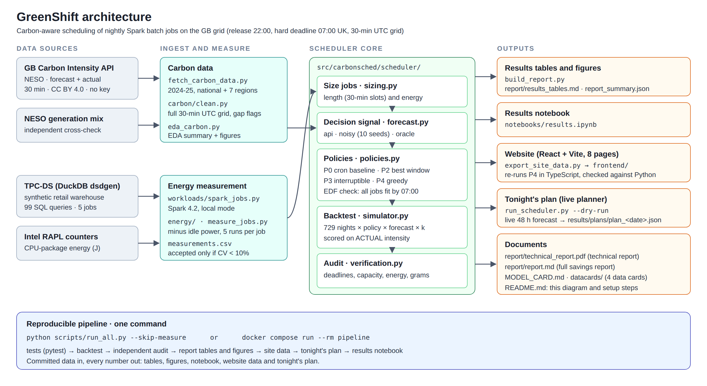
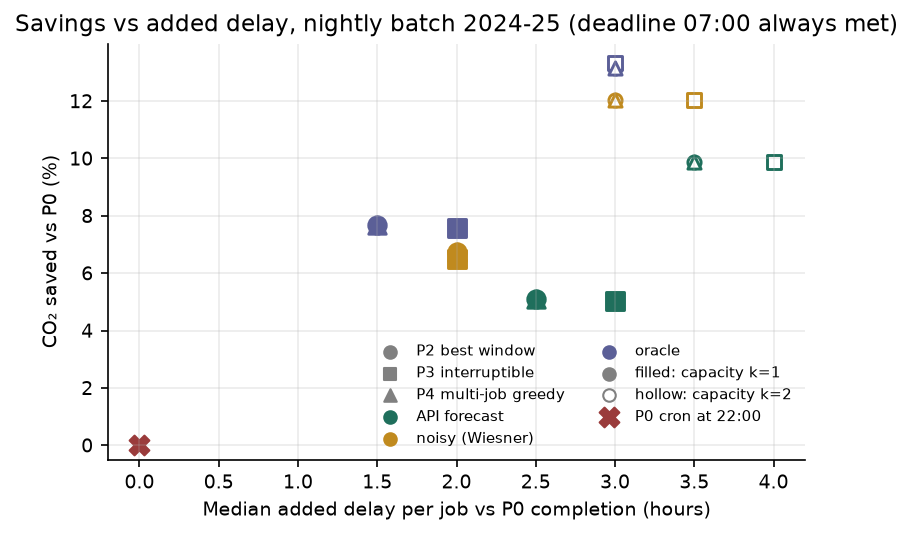

# GreenShift: Carbon-Aware Scheduling of Nightly Spark Batch Jobs

**Technical report** · UE24AM343AB3 Big Data Systems & Responsible AI Engineering · Mini-project, Track G (Governance, Compliance and Sustainability)  
**Team:** Vismay HS (PES1UG24AM325) · Sharvesh K (PES1UG24AM260) · Ashwin C H (PES1UG24AM900)  
**Code and data:** [github.com/VismayHS/GreenShift](https://github.com/VismayHS/GreenShift) · every number here is regenerated by `python scripts/run_all.py --skip-measure`

## 1. Problem

*A data team wants to cut emissions from nightly jobs without missing deadlines.* A job's emissions are its energy times the carbon intensity (CI) of the electricity it runs on: `gCO₂ = kWh × PUE × CI(t)`. Moving a job in time does not change its kWh, only `CI(t)`. Great Britain's grid CI changes through the night as wind, imports and gas output change, and NESO publishes a 48-hour CI forecast every half-hour. GreenShift uses that forecast to choose, each night, when each of five Spark jobs runs inside a fixed window (release **22:00**, hard deadline **07:00** UK time). It then reports the CO₂ saved against the team's current cron schedule and the delay this adds. The design follows Wiesner et al. (*Let's Wait Awhile*, Middleware '21), whose GB result we replicate.

## 2. Data

| Dataset | Use | Licence |
|---|---|---|
| GB Carbon Intensity API (NESO) | National forecast (decisions) and actual (scoring), 2024-01-01 to 2026-01-01, 30 min, UTC; regional forecasts | CC BY 4.0, no key |
| NESO historic generation mix | Independent cross-check of the API actual | CC BY 4.0 |
| TPC-DS via DuckDB `dsdgen` | Synthetic retail warehouse and SQL for the Spark jobs | TPC EULA / fair use |

Electricity Maps, suggested by the brief, was **substituted**: its historical datasets are now limited to approved academic users and the free API covers only the last 24 h. NESO data comes from the system operator itself, is finer-grained (30 min) and needs no key. Data cards for all four sources are in `datacards/`. The workload is *derived from TPC-DS; results are not comparable with published TPC-DS results.*

**What the data shows** (35,088 national half-hours; 74 forecast and 31 actual slots missing in three source outages):

- **Night vs day.** The 22:00-07:00 window averages **116.7** gCO₂/kWh against **133.4** for 07:00-22:00, and the day's cleanest half-hour falls inside the window on 58.9% of days.
- **The swing inside a night is what shifting exploits.** On the median night the dirtiest and cleanest half-hours differ by **48 gCO₂/kWh** (about 1.5×), and by 2× or more on 18% of nights. The summer solar dip (about 78 at 13:00) is cleaner still, but lies outside the window.
- **Forecast quality.** The national forecast's mean absolute error is **9.72 gCO₂/kWh, 7.6% of the mean** (bias −0.07, n = 35,014), larger than the 5% error Wiesner et al. assumed.
- **Cross-check.** The API actual agrees with NESO's separate historic series at r = **0.993** (MAE 4.66).

## 3. Energy measurement method

**Meter.** Intel RAPL (Running Average Power Limit) CPU-package counters, read via the Windows Energy Meter Interface or Linux powercap (wrap-safe). A linear utilisation model, calibrated against RAPL by least squares, is a labelled fallback for machines without counters. On CPU-burn validation the model agreed with RAPL within 0.4 to 5.1% on Windows. On Linux the uncalibrated model was 26.4% off, which is why the protocol recalibrates it on every machine.

**Protocol** (`scripts/measure_jobs.py`, guarded by `energy/preflight.py`): AC power and best-performance mode, sleep inhibited, and a charger disconnect or suspend **aborts** the session. It takes a 60 s idle baseline at the start and end, one discarded warm-up per job, then five measured runs per job in randomised order with 20 s cool-downs. **Attributable energy = gross RAPL − idle power × duration**. A job is accepted only if its runs agree (coefficient of variation < 10%) and each run lasts ≥ 30 s.

**Workload.** Five jobs built from grouped TPC-DS queries on Spark 4.2 (local mode, 4 cores, 8 GB driver): `daily_sales_report`, `customer_analytics`, `inventory_supply_chain`, `cross_channel_promo` (the only splittable job) and `returns_audit`. SF5 exhausted the Java heap, so the catalogue uses SF1 with each query group repeated (10 to 36 times) so every run is well over 30 s.

**Scope.** The measurement method and tooling are complete. A full five-run campaign could not be completed on the available laptop, so the backtest uses modelled job lengths with equal energy per job and reports savings as percentages. RAPL sees only the CPU package (no DRAM, disk, network or power-supply losses), so it would underestimate absolute energy but not the percentage saved.

## 4. Scheduler design

Each night has release *r* = 22:00 and deadline *D* = 07:00 UK, handled in UTC on 30-minute slots (18 slots; 16 or 20 on clock-change nights). Job *j* has length *dⱼ* slots, energy *Eⱼ* and a splittable flag; at most *k* jobs run at once (*k* = 1 or 2, a YARN queue's slots). The objective is Σⱼ *Eⱼ* × mean forecast CI over *j*'s slots.

| Policy | Rule |
|---|---|
| **P0** cron | All jobs start at 22:00, back to back in catalogue order, *k* at a time (the baseline) |
| **P2** best window | Each job takes the contiguous block with the lowest mean forecast that still fits |
| **P3** interruptible | As P2, but the splittable job may use its cleanest non-adjacent slots |
| **P4** multi-job greedy | Largest energy first. Before accepting a slot, an earliest-deadline-first (EDF) construction must still place every remaining job by 07:00. Cron is kept if the plan would not lower forecast emissions |

**Forecast modes.** `api` is the real archived NESO forecast. `noisy` is actual + N(0, 5% of the annual mean) over 10 seeds, as in the paper. `oracle` is the actual itself, an upper bound only.

**Two rules keep the results honest.** (1) *No lookahead:* policies receive only the forecast array, and a test changes the actual values and checks that `api` plans do not move. (2) *Score on actual:* every gram is energy × the **actual** CI of the slots the job really occupied, so a bad forecast shows up as a smaller saving, never a hidden one.

**Correctness.** 50 automated tests (pytest) check: no missed deadline or capacity violation on random workloads; energy conservation; zero saving on a flat CI; best window equal to brute force; clock-change nights, RAPL counter wrap-around and missing API fields.

An **independent auditor** (`scheduler/verification.py`) re-derives every backtest row from the slot table and the raw actual series. Result: 437,448 rows, 0 deadline misses, 0 capacity violations, energy conserved.

## 5. Experimental setup and pipeline

- **Nights.** Every night of 2024-2025: 729 nightly windows used. Ten night-scenarios with source outages or at data boundaries were skipped and are listed in `backtest_meta.json`.
- **Matrix.** 4 policies × 3 forecast modes (10 noisy seeds) × *k* ∈ {1, 2} × 5 jobs, plus the replication scenario: 437,448 rows.
- **Job lengths.** 30, 60, 60, 120 and 60 min, with equal energy per job, so results are reported as percentages.
- **Statistics.** % saved = 1 − Σ policy grams / Σ cron grams, pooled over jobs and nights. Intervals are 95% percentile bootstraps over nights (2,000 resamples, seed 0). Delay is a job's completion minus its own cron completion.
- **Pipeline.** `scripts/run_all.py` (or `docker compose run --rm pipeline`) runs tests → backtest → audit → tables and figures → site data → live plan → results notebook. The notebook (`notebooks/results.ipynb`) recomputes the headline from the raw rows and asserts it matches the report.

## 6. Results

| Policy (*k* = 1) | Forecast | CO₂ saved vs cron [95% CI] | Median delay | p95 delay | Deadline misses |
|---|---|---|---|---|---|
| P2 best window | API | 5.09% [4.52, 5.70] | 2.5 h | 7 h | 0 |
| P3 interruptible | API | 5.04% [4.45, 5.66] | 3 h | 7 h | 0 |
| **P4 multi-job greedy** | **API** | **5.09% [4.53, 5.72]** | **2.5 h** | **7 h** | **0** |
| P4 multi-job greedy | Noisy (paper's model) | 6.73% [6.14, 7.32] | 2 h | 6.5 h | 0 |
| P4 multi-job greedy | Oracle (ceiling) | 7.68% [7.10, 8.26] | 1.5 h | 6.5 h | 0 |

**Headline.** With the forecast a real deployment would have, GreenShift cuts the nightly batch's emissions by **about 5%** with **zero missed deadlines**, and the typical job finishes 2.5 h later. The energy-weighted CI the batch runs at falls from 115.6 to 109.7 gCO₂/kWh (oracle 106.7). With two parallel slots (*k* = 2), P4 saves **9.87%** [8.99, 10.76], because cron then crowds the work into the first hours after 22:00, usually the dirtiest of the night. P2 and P4 coincide because all jobs have equal energy, so largest-first ordering has no effect.

**Where it comes from.** Summer nights save the most: **8.41%** against 3.42% in winter. The mean summer night falls from 136.6 gCO₂/kWh at 22:00 to 101.7 at its low, a 35 g drop against 16 to 21 g in other seasons. Weekday and weekend nights save about the same (5.12% and 5.03%).

**Not every night wins.** The median night saves 2.44%, and on **26.5% of nights the API plan emitted more than cron** because the forecast pointed to a slot that turned out dirtier; with the oracle this never happens. The real forecast captures **66%** of the oracle saving (75% at *k* = 2), while the paper's noise model captures 88%. Real forecast error is the main limit on the benefit.

**Replication of Wiesner et al.** (one 30-minute job, baseline 01:00 UK, policy P2):

| Window | API | Noisy (as in paper) | Oracle | Paper, GB 2020 |
|---|---|---|---|---|
| ±2 h | 3.03% | **4.45%** [4.01, 4.89] | 6.58% | **4.3%** |
| ±8 h | 5.02% | **10.28%** [9.43, 11.21] | 12.74% | **7.4%** |

At ±2 h our 95% interval contains the published 4.3%, which supports the method. At ±8 h we find more on 2024-25 data, whose generation mix differs from 2020 (more wind; Britain's last coal plant closed in 2024). This is a check of the method, not a reproduction of the paper's numbers.

## 7. Responsible AI and limitations

| Issue | How it is handled |
|---|---|
| **Overstating the benefit** | The headline uses the real forecast scored on actual CI, with a 95% interval. The oracle is labelled a ceiling, and the 26.5% of losing nights is reported |
| **Average vs marginal CI** | We use average, production-based CI (location-based), as the paper did. The plant that responds to extra load may differ, so true avoided emissions can be higher or lower. Stated with every result |
| **Who pays for the delay** | A hard 07:00 deadline for every job, median and p95 delay reported, and any job can be marked non-movable |
| **Meter scope and laptop-to-fleet** | RAPL measures CPU package only. Fleet figures use a stated SCALE and PUE (1.0, to avoid an unverified data-centre value) and are always labelled *projection* |
| **Transparency** | Every live plan is saved with a per-job reason (`results/plans/`). The website re-runs the planner in TypeScript and checks itself against the Python plan |
| **Modelled job lengths** | Savings are reported as percentages; absolute grams would need measured energy per job |
| **Rebound** | Cheaper-feeling compute can invite more jobs that cancel the saving. Named as an adopter risk, not measured |

Sukprasert et al. (EuroSys '24) find that simple temporal-shifting policies capture most of the practical gain, which is well below the ideal. Our 5% (API) against 7.7% (oracle) is consistent with that.

## 8. Conclusion and next step

Carbon-aware shifting of a nightly Spark batch on the GB grid saves about **5%** of its emissions with the real forecast (about 10% with two parallel slots), with **no missed deadlines** and a median delay of 2.5 h. The method reproduces the published GB result at ±2 h. Future work: measure each job with the RAPL protocol so the backtest can report absolute grams as well as percentages.

## References

1. Wiesner, P., Behnke, I., Scheinert, D., Gontarska, K., Thamsen, L. *Let's Wait Awhile: How Temporal Workload Shifting Can Reduce Carbon Emissions in the Cloud.* Middleware '21. doi:10.1145/3464298.3493399.
2. Sukprasert, T., Souza, A., Bashir, N., Irwin, D., Shenoy, P. *On the Limitations of Carbon-Aware Temporal and Spatial Workload Shifting in the Cloud.* EuroSys '24. doi:10.1145/3627703.3650079.
3. Radovanovic, A., et al. *Carbon-Aware Computing for Datacenters.* arXiv:2106.11750 (2021).
4. ISO/IEC 21031:2024, *Software Carbon Intensity (SCI) specification*; Green Software Foundation, https://sci-guide.greensoftware.foundation/
5. NESO Carbon Intensity API, https://carbon-intensity.github.io/api-definitions/ (CC BY 4.0); NESO historic generation mix, https://www.neso.energy/data-portal/historic-generation-mix (CC BY 4.0).
6. TPC Benchmark DS, specification v4.0.0, Transaction Processing Performance Council.
